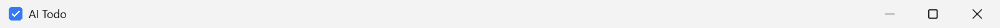

# Windows 原生浅色标题栏

主界面使用白色（`#ffffff`）背景。此次保留 Electron 默认 Windows 原生标题栏，只在创建窗口前把 Windows 应用的 `nativeTheme.themeSource` 固定为 `light`，并为主窗口设置 `accentColor: false`，避免系统的标题栏强调色造成不协调。

主窗口仍使用 `frame: true` 与 `titleBarStyle: 'default'`，没有启用标题栏叠加、无边框或网页自绘按钮。图标、应用名称、系统菜单、最小化、最大化/还原、关闭、拖动、双击和边缘缩放均由原生窗口处理，按钮悬停/按下样式继续由 Windows 绘制。

只覆盖 Windows 应用本身的浅色外观，不修改 Windows 系统主题设置。悬浮窗口的无边框、透明、置顶、窗口区域及鼠标命中配置未修改；任务数据与 API 配置读写路径未修改。

## 验证方式

`tests/desktop/titlebar.spec.js` 分别使用普通启动与 `--force-dark-mode` 启动真实 Electron 窗口。测试包括：

- 查询 Electron 原生主题、强调色状态，以及 DWM 深色标题栏标志。
- 通过 Win32 `PrintWindow` 捕获真正的非客户区；普通网页截图和 Electron 窗口缩略图可能不含系统标题栏，不能用它们判断标题栏颜色。
- 查询原生窗口图标、标题、标题栏/系统菜单/最小化/最大化/可缩放边框的样式与命中区域。
- 投递 Windows 原生标题栏双击消息，核对最大化和还原。
- 投递原生最小化、最大化、还原、关闭系统命令；检查关闭主窗口后悬浮球和托盘保留，以及托盘重新打开主窗口。
- 通过原生窗口边界 API 检查移动和调整大小。

使用独立测试目录，没有读写真实任务或 `.env`，没有修改注册表、系统主题或移动物理鼠标。标题栏双击/按钮命令通过真实 HWND 的 Windows 消息路径测试；拖动区域和缩放边缘通过原生命中测试与窗口移动/缩放检查。尚未做物理鼠标人工拖动、边缘拖拽及按钮悬停/按下的人工检查。

本机 Windows 应用主题为深色（`AppsUseLightTheme=0`），捕获到的 Todo 标题栏背景为 RGB(243,243,243)，DWM 深色标志为 false。普通启动和深色启动覆盖均通过；完整桌面回归 8 项通过，打包程序回归 7 项通过（开发模式用例跳过）。

浅色标题栏证据（测试窗口）：

官方 API：[nativeTheme](https://www.electronjs.org/docs/latest/api/native-theme)、[BrowserWindow](https://www.electronjs.org/docs/latest/api/browser-window)。
