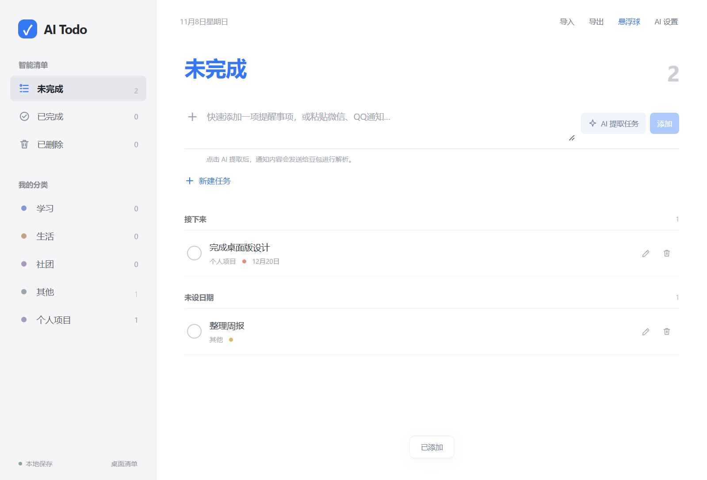
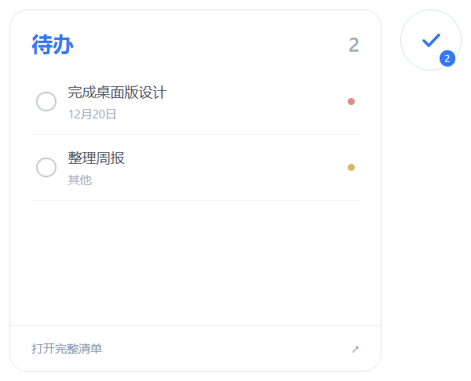

# Windows 桌面验证记录

首次桌面验证：2026-11-08；本次公开快照准备复验：2026-11-09。环境：Windows 11（10.0.26200）、x64、Node 24；原生窗口检查 DPI 144（150%）。测试使用 `.test-profiles` 内独立目录，没有迁移或修改真实浏览器任务。

## 已执行

| 检查 | 结果 |
| --- | --- |
| `npm.cmd ci` | 成功；按 lockfile 安装依赖，未升级依赖或改写 lockfile |
| `npm.cmd test` | 13 项通过：数据校验、旧备份导入、合并、任务操作、备份与损坏保护、浮层布局、AI 返回与错误、完成反馈显示层，以及新增的打包隐私路径规则 |
| `npm.cmd run test:desktop` | 8 项通过：真实 Electron 生命周期、Vite 开发启动、导入导出、AI 配置/逐条确认、连续完成、减少动态与跨窗口同步、原生浅色标题栏 |
| `npm.cmd run dist:win` | 成功生成 NSIS Windows x64 安装包 |
| 对 `release/win-unpacked/AI Todo.exe` 运行桌面回归 | 保留 2026-11-08 的原记录：7 项通过、开发模式用例按设计跳过；本轮未重跑该项 |
| `npm.cmd run check:package` | 通过：入口与路径正确，项目 MIT LICENSE 与源文件相同，未包含 `.env`、真实任务、备份、本机 AI 配置或当前本地 API Key |
| 提取实际 NSIS 安装器载荷 | 通过：内层 app.asar 与已检查的解包目录逐字节一致；再次核对 MIT LICENSE、受保护路径及常见凭据模式 |
| `git diff --check` | 通过；只提示 Windows 换行规范，不影响构建 |

打包程序回归命令：

```powershell
$env:TODO_PACKAGED_EXE = (Resolve-Path 'release/win-unpacked/AI Todo.exe').Path
npm.cmd exec -- playwright test
Remove-Item Env:TODO_PACKAGED_EXE
```

## 行为覆盖

- 添加任务及自定义分类，设置日期和优先级；编辑、完成、删除、恢复；重启持久化。
- 关闭主窗口后进程保留，悬浮球出现；点击球重新打开主窗口，前台主窗口隐藏悬浮区。
- 另一个普通原生窗口取得前台时，悬浮球恢复且主窗口仍在。
- 悬停展开，移到预览不关闭，离开区域后收起；预览完成任务实时同步主清单。
- 执行真实托盘菜单回调，隐藏/显示球、重新打开主窗口、完全退出；退出码为 0。
- 原生 Win32 查询确认 `WS_EX_TOPMOST`，球中心命中浮窗，透明角落从原生窗口区域排除并能命中下面的窗口。
- 旧浏览器数组合并导入、重复导入去重、全部任务导出。
- AI Key 系统加密落盘且不读回 renderer；模拟模型返回多个任务后可逐条选择、修改并保存。
- 动画计时暂停时任务也已落盘，数量立即变化；同帧重复点击不会翻回状态，多条任务可连续完成。
- 分类分组移动只有一份任务；Enter / Space 焦点接续、减少动态直接更新、保存失败保持旧状态、悬浮数量与主清单同步均通过。
- 原生标题栏在当前系统深色环境及强制深色启动下保持浅色；PrintWindow 实际截取标题栏背景为 RGB(243,243,243)。原生图标、样式、拖动/缩放命中、双击最大化/还原、窗口系统命令及移动/缩放检查通过。详见 [标题栏验证范围](TITLEBAR.md)。

## 证据

原生命中查询结果：

```json
{"topmost":true,"hasNativeRegion":true,"ballInRegion":true,"transparentCornerExcluded":true,"ballHitsWindow":true,"transparentCornerPassesThrough":true,"dpi":144}
```

主界面（测试任务）：



悬浮预览（测试任务）：



安装器：`release/AI-Todo-0.2.0-x64-Setup.exe`（版本 0.2.0，Windows x64 NSIS），122,097,995 字节，约 116.44 MiB。

SHA-256：`B3216318AD50BA92A7CAC03427B33E3EA27ADF242ADE466C8A8B709D8B49C5B9`。

项目许可证位于安装载荷的 `resources/app.asar/LICENSE`，与源码根目录的标准 MIT LICENSE 相同。`check:package` 对任务备份、AI 配置临时文件和 Python 缓存也执行路径检查。

安装包未签名，没有代码签名证书。Windows SmartScreen 可能显示未知发布者或阻止运行提示；本记录不表示已签名或已获得 SmartScreen 信誉。

## 验证范围与剩余限制

鼠标事件通过 Electron/Chromium 输入自动化执行，原生指针位置分支使用独立测试坐标；同时执行了 Win32 的真实窗口命中查询。没有人工移动物理鼠标跨显示器或人工点击系统通知区菜单。托盘退出检查执行的是实际菜单回调及进程退出。

尚未执行 NSIS 安装向导的完整人工安装/卸载；已运行安装包内对应的打包程序并检查包内容。未在 macOS、其他 DPI/多显示器排列、远程桌面或独占全屏软件上验证。没有代码签名证书，也未连接真实豆包模型消耗额度。代码没有推送，未创建 Release 或上传安装包。
